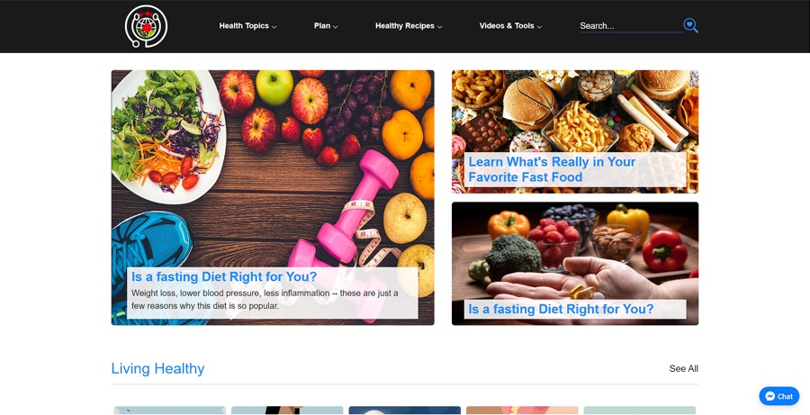
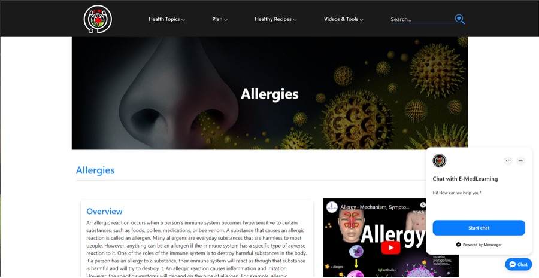
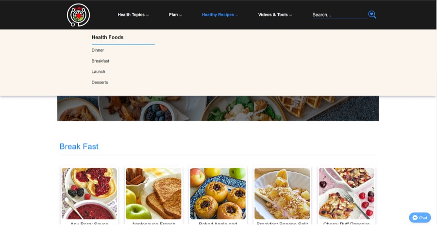
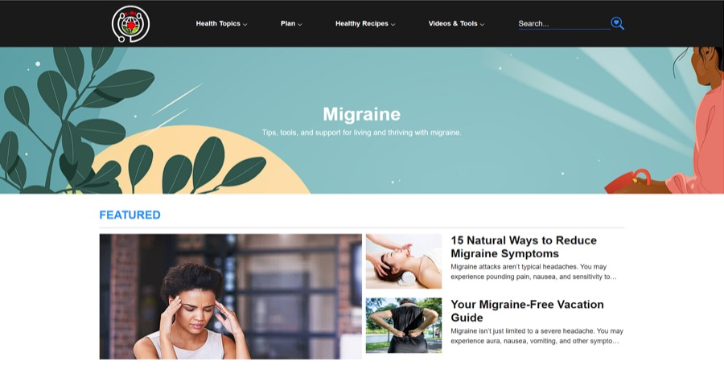

# E-MedLearning (E-ML)

> **Mini Project 2** from the KodeGo Full-Stack Web Development Bootcamp (2022).
> **Disclaimer:** for educational purposes only. The content is not medical advice, and the images and articles belong to their respective owners.

A responsive health-education website with articles on health topics, healthy-eating plans, recipes and explainer videos, plus a **Facebook Messenger** chat plugin.

**Live demo:** https://neo64347.github.io/e-ml.io/

| | |
|---|---|
|  |  |
|  |  |

## Sections
| Section | Folder | Examples |
|---|---|---|
| Health topics | `health-topic/`, `brst-cncr/` | Breast cancer, IBD, migraine, MS, rheumatoid arthritis, type 2 diabetes |
| Health challenges / plans | `plan/` | Mindful eating, sugar savvy, move your body, gut health, mood foods |
| Healthy recipes | `health-recipe/` | Breakfast, lunch, dinner, desserts |
| Videos & tools | `video&tools/` | Allergies, Alzheimer's, arrhythmias, atherosclerosis |

## Tech stack
HTML · CSS (responsive media queries) · Bootstrap · JavaScript · Messenger Platform · GitHub Pages

## Run locally
```bash
git clone https://github.com/neo64347/e-ml.io.git
cd e-ml.io
python3 -m http.server 8000   # then open http://localhost:8000
```

## Author
**John Ed Manauis**: [Portfolio](https://neo64347.github.io/portfolio-manauis/) · [LinkedIn](https://www.linkedin.com/in/johnedmanauis/)
